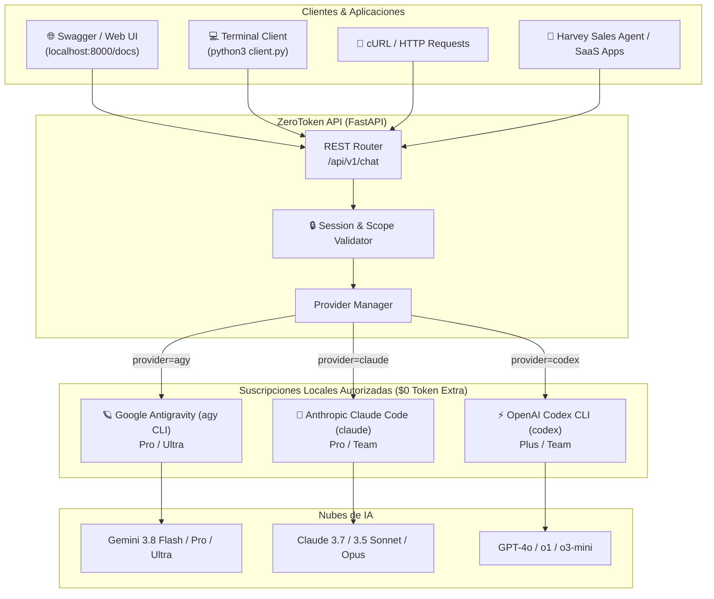

# ZeroToken API ⚡

<p align="center">
  
  
  
  
  
</p>

> **Universal AI Chat Gateway powered by your local CLI subscriptions.**  
> Zero API keys needed — Zero per-token cloud bills.

---

## 💡 ¿Qué es ZeroToken API?

**ZeroToken API** convierte tus suscripciones comerciales activas (**Google Antigravity CLI `agy`**, **Anthropic Claude Code `claude`** y **OpenAI Codex CLI `codex`**) en un servicio REST estandarizado de alto rendimiento.

En lugar de pagar facturas por cada millón de tokens consumidos en APIs de OpenAI, Anthropic o Google Vertex, ZeroToken API canaliza las peticiones a través de las herramientas CLI locales que ya tienes autorizadas con tu suscripción fija, entregando respuestas JSON normalizadas, métricas de tokens y persistencia multi-turno.

---

## 🏛️ Arquitectura



---

## ✨ Características Principales

* 💸 **Facturación Cero por Token ($0):** Aprovecha el 100% del cupo mensual de tus planes Pro/Team sin tarjetas de crédito asociadas a facturación por consumo.
* 🔄 **Multi-Proveedor Unificado:** Cambia dinámicamente entre Gemini, Claude y GPT en el mismo payload enviando `"provider": "agy" | "claude" | "codex"`.
* 🧠 **Memoria Multi-Turno Automática:** Gestiona hilos de conversación usando `conversation_id`. ZeroToken API mantiene el hilo temporal en el CLI correspondiente.
* 🛡️ **Aislamiento Seguro de Sesiones:** Validación rigurosa de alcance (`404 ConversationNotFoundError` ante UUIDs inválidos) y sandbox conversacional que previene la ejecución indebida de comandos de sistema o lectura cruzada de discos.
* 📊 **Métricas de Uso Detalladas:** Normaliza `input_tokens`, `output_tokens`, `thinking_tokens` y `duration_seconds` en cada respuesta.
* 🖥️ **Cliente de Terminal Interactivo:** Incluye `client.py` con comandos estilo chat interactivo (`/new`, `/provider`, `/id`).
* 📖 **Documentación Swagger / OpenAPI Integrada:** Prueba endpoints interactivamente desde `http://localhost:8000/docs`.

---

## 🚀 Inicio Rápido

### Requisitos Previos

* Python 3.10 o superior
* Al menos un CLI instalado y autenticado en tu máquina:
  * Google Antigravity: `agy`
  * Anthropic Claude Code: `claude`
  * OpenAI Codex: `codex`

### Instalación

1. Clona el repositorio:
   ```bash
   git clone https://github.com/knne777/ZeroToken-API.git
   cd ZeroToken-API
   ```

2. Instala las dependencias:
   ```bash
   pip install -r requirements.txt
   ```

3. Inicia el servidor:
   ```bash
   uvicorn app.main:app --host 0.0.0.0 --port 8000 --reload
   ```

   El servicio estará disponible en:
   * **API Base:** `http://localhost:8000`
   * **Swagger UI:** `http://localhost:8000/docs`
   * **ReDoc:** `http://localhost:8000/redoc`

---

## 💬 Formas de Uso

### 1. Cliente Interactivo de Consola (`client.py`)

Para chatear inmediatamente como en un bot de terminal con memoria automática:

```bash
python3 client.py
```

Comandos en el chat:
* `/new` - Inicia una nueva conversación desde cero.
* `/provider [agy|claude|codex]` - Cambia de proveedor en caliente.
* `/id` - Muestra el ID de conversación activo.
* `exit` - Finaliza la sesión.

---

### 2. Peticiones HTTP con `cURL`

#### Paso A: Iniciar una Nueva Conversación (Turno 1)
Envía tu mensaje sin especificar `conversation_id`:

```bash
curl -s -X POST 'http://localhost:8000/api/v1/chat' \
  -H 'Content-Type: application/json' \
  -d '{
    "message": "Hola, mi color favorito es el verde y tengo una gata llamada Luna.",
    "provider": "agy",
    "model": "gemini-3.8-flash-high"
  }'
```

**Respuesta recibida:**
```json
{
  "provider": "agy",
  "model": "gemini-3.8-flash-high",
  "conversation_id": "fbd5646d-e052-4201-a67a-f622b219f481",
  "response": "¡Hola! Mucho gusto. Queda registrado que tu color favorito es el verde y tienes una gata llamada Luna.",
  "status": "SUCCESS",
  "num_turns": 1,
  "duration_seconds": 3.42,
  "usage": {
    "input_tokens": 7524,
    "output_tokens": 352,
    "thinking_tokens": 210,
    "cache_read_tokens": 0,
    "total_tokens": 7876
  }
}
```

#### Paso B: Continuar el Mismo Hilo (Turno 2 en adelante)
Copia el `conversation_id` recibido en el paso anterior:

```bash
curl -s -X POST 'http://localhost:8000/api/v1/chat' \
  -H 'Content-Type: application/json' \
  -d '{
    "message": "¿Cómo se llama mi mascota y qué color me gusta?",
    "provider": "agy",
    "conversation_id": "fbd5646d-e052-4201-a67a-f622b219f481"
  }'
```

**Respuesta recibida:**
```json
{
  "provider": "agy",
  "model": "gemini-3.8-flash-high",
  "conversation_id": "fbd5646d-e052-4201-a67a-f622b219f481",
  "response": "Tu gata se llama Luna y tu color favorito es el verde.",
  "status": "SUCCESS",
  "num_turns": 2,
  "duration_seconds": 2.15,
  "usage": {
    "input_tokens": 15638,
    "output_tokens": 85,
    "thinking_tokens": 40,
    "cache_read_tokens": 0,
    "total_tokens": 15723
  }
}
```

---

### 3. Integración en Python

```python
import requests

API_URL = "http://localhost:8000/api/v1/chat"

# 1. Primer turno
r1 = requests.post(API_URL, json={
    "message": "Hola, resume en una frase qué es la computación cuántica.",
    "provider": "agy"
}).json()

print("Respuesta 1:", r1["response"])
conv_id = r1["conversation_id"]

# 2. Segundo turno (con memoria)
r2 = requests.post(API_URL, json={
    "message": "Ahora explícaselo a un niño de 8 años.",
    "provider": "agy",
    "conversation_id": conv_id
}).json()

print("Respuesta 2:", r2["response"])
```

---

### 4. Integración en JavaScript / TypeScript (Node o Navegador)

```javascript
async function chat(message, conversationId = null) {
  const response = await fetch("http://localhost:8000/api/v1/chat", {
    method: "POST",
    headers: { "Content-Type": "application/json" },
    body: JSON.stringify({
      message,
      provider: "agy",
      conversation_id: conversationId
    })
  });

  const data = await response.json();
  return data;
}

// Uso:
const turn1 = await chat("Hola, soy desarrollador de Conta360.");
console.log(turn1.response);

const turn2 = await chat("¿Qué empresa te mencioné?", turn1.conversation_id);
console.log(turn2.response);
```

---

## 📡 Referencia de Endpoints

| Método | Endpoint | Descripción |
| :--- | :--- | :--- |
| `POST` | `/api/v1/chat` | Enviar un mensaje de chat (inicio o continuación de conversación). |
| `GET` | `/api/v1/providers` | Lista el estado de instalación y rutas de los 3 proveedores (`agy`, `claude`, `codex`). |
| `GET` | `/api/v1/models` | Lista los modelos disponibles por proveedor (`?provider=agy`). |
| `GET` | `/health` | Chequeo de salud del servicio (healthcheck). |
| `GET` | `/` | Información general de la API y enlaces a la documentación. |

---

## 📋 Parámetros de `POST /api/v1/chat`

| Campo | Tipo | Obligatorio | Por Defecto | Descripción |
| :--- | :--- | :---: | :---: | :--- |
| `message` | `string` | **Sí** | - | Mensaje o prompt del usuario. |
| `provider` | `string` | No | `"agy"` | Proveedor a utilizar (`"agy"`, `"claude"`, `"codex"`). |
| `conversation_id` | `string` | No | `null` | UUID de conversación existente. Si se omite, se crea una nueva. |
| `model` | `string` | No | `null` | Nombre del modelo específico soportado por el proveedor. |
| `effort` | `string` | No | `"high"` | Nivel de razonamiento (`"low"`, `"medium"`, `"high"`). |
| `system_prompt` | `string` | No | `null` | Prompt de sistema para configurar la personalidad o rol. |
| `temperature` | `float` | No | `null` | Temperatura de muestreo (0.0 a 2.0). |

---

## 🧩 Proveedores y Modelos Disponibles

### 🪐 Google Antigravity (`agy`)
* `gemini-3.8-flash-high` *(Recomendado por velocidad y calidad)*
* `gemini-3.8-pro`
* `gemini-3.8-pro-max`
* `gemini-3.8-ultra`

### 🧠 Anthropic Claude Code (`claude`)
* `claude-3-7-sonnet`
* `claude-3-5-sonnet`
* `claude-3-5-haiku`
* `claude-3-opus`

### ⚡ OpenAI Codex CLI (`codex`)
* `gpt-4o`
* `gpt-4o-mini`
* `o1`
* `o3-mini`

---

## ⚙️ Variables de Entorno

Puedes personalizar el comportamiento de ZeroToken API mediante variables de entorno:

| Variable | Tipo | Por Defecto | Descripción |
| :--- | :---: | :---: | :--- |
| `ZEROTOKEN_PORT` | `int` | `8000` | Puerto de escucha de la API. |
| `ZEROTOKEN_HOST` | `string` | `"0.0.0.0"` | Dirección de enlace de red. |
| `ZEROTOKEN_DEFAULT_PROVIDER` | `string` | `"agy"` | Proveedor predeterminado si no se incluye en el request. |
| `ZEROTOKEN_TIMEOUT` | `float` | `300.0` | Tiempo límite en segundos para la ejecución del CLI. |

---

## 🧪 Pruebas Automatizadas

Ejecuta la suite de pruebas unitarias y de integración:

```bash
python3 -m pytest tests/ -v
```

Las pruebas cubren:
* Verificación de endpoints de salud y raíz.
* Descubrimiento de proveedores y modelos.
* Mocking de llamadas a los CLI.
* Validación estricta de aislamiento y retorno `404 ConversationNotFoundError` ante UUIDs inexistentes.

---

## 🛡️ Seguridad y Aislamiento

1. **Sin Exposición de Llaves:** Al no requerir `OPENAI_API_KEY`, `ANTHROPIC_API_KEY` ni `GEMINI_API_KEY`, no existen credenciales de pago que puedan filtrarse.
2. **Sandbox Conversacional:** Los turnos se ejecutan bloqueando herramientas de modificación de archivos del host o introspección de logs entre usuarios.
3. **Validación de Ámbito:** Si una petición intenta acceder a un identificador de conversación inexistente, se rechaza inmediatamente para evitar lecturas de sesiones ajenas.

---

## 📄 Licencia

Este proyecto está bajo la Licencia **MIT**. Consulta el archivo `LICENSE` para más detalles.
